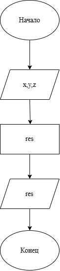

# Домашнее задание к работе номер 5
## Условие задачи
Создать программу вычисления указанной величины. Результат проверить при заданных исходных значениях.
## 1. Алгоритм и блок-схема
### Алгоритм:
1. Начало
2. Объявить переменные:
- **x**
- **y**
- **z**
3. Составить выражение и найти искомую величину.
4. Конец.
### Блок-схема:

## 2. Реализация программы
```c
#include <stdio.h>
#include <math.h>

void main() {
    double x,y,z;
    
    scanf_s("%lf", &x);
    scanf_s("%lf", &y);
    scanf_s("%lf", &z);

    double res = (pow(y + cbrt(x - 1.0), 0.25)) / (fabs(x - y) * (sin(z) * sin(z) + tan(z)));

    printf("res = %.5f\n", res);

}
```
## 3. Результаты работы программы
Пример:
17.421
10.365e-3
0.828e5

res = 0.33056
## 4. Информация о разработчике
Литуновский Максим Дмитриевич, бТИИ-261
